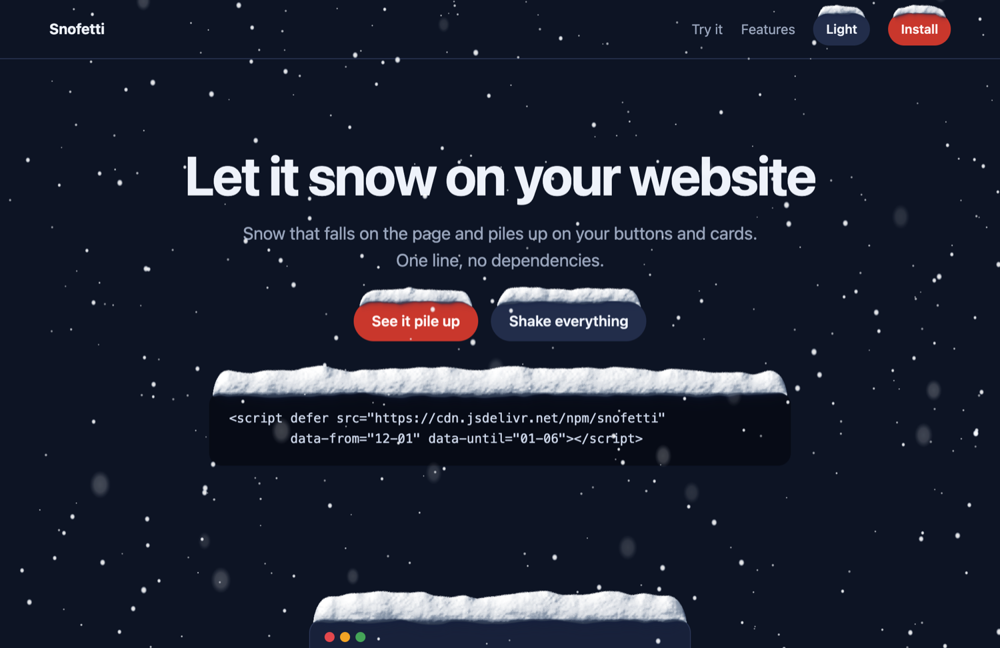
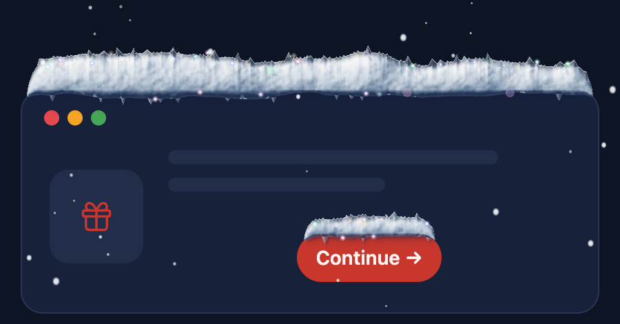

# Snofetti

Snow that falls on your website and piles up on your buttons, cards and images.

Add one line. It needs no setup and has no dependencies. Give it two dates and it turns itself on for the holidays and off again afterwards, every year.

**[Try it live](https://vedas-dixit.github.io/Snofetti/)** · [npm](https://www.npmjs.com/package/snofetti) · [GitHub](https://github.com/vedas-dixit/Snofetti)

[](https://vedas-dixit.github.io/Snofetti/)

- **Piles up on your page.** Snow settles on real elements, grows over time, and falls off when you press a button or shake a window.
- **Works on real websites.** It follows scrolling and sticky headers, hides under dialogs and menus, and matches light and dark pages.
- **Polite by default.** It never blocks a click, stands still for people who prefer less motion, and does nothing in a hidden tab.
- **Small.** About 16 kB gzipped, no dependencies.

## Add it to your site

### Any website

Paste this before `</body>`:

```html
<script defer src="https://cdn.jsdelivr.net/npm/snofetti"
        data-from="12-01" data-until="01-06"></script>
```

That is all. Snow falls from 1 December to 6 January. Leave the two dates out and it snows all year.

### With npm

The package is [snofetti on npm](https://www.npmjs.com/package/snofetti).

```sh
npm install snofetti
```

```js
import { snofetti } from 'snofetti';

snofetti({ from: '12-01', until: '01-06' });
```

If you want the defaults and nothing else, one import is enough:

```js
import 'snofetti/auto';
```

### React and Next.js

```jsx
import { Snofetti } from 'snofetti/react';

export default function RootLayout({ children }) {
  return (
    <html lang="en">
      <body>
        {children}
        <Snofetti from="12-01" until="01-06" />
      </body>
    </html>
  );
}
```

Render it once, anywhere. The component is a client component, so it can sit inside a server layout. It removes the snow when it unmounts.

### Vue

```vue
<script setup>
import { onMounted, onUnmounted } from 'vue';
import { snofetti } from 'snofetti';

let snow;
onMounted(() => { snow = snofetti({ from: '12-01', until: '01-06' }); });
onUnmounted(() => snow?.stop());
</script>
```

### Svelte

```svelte
<script>
  import { onMount } from 'svelte';
  import { snofetti } from 'snofetti';

  onMount(() => {
    const snow = snofetti({ from: '12-01', until: '01-06' });
    return () => snow.stop();
  });
</script>
```

### Astro

```astro
<script>
  import { snofetti } from 'snofetti';
  snofetti({ from: '12-01', until: '01-06' });
</script>
```

Calling `snofetti()` on a server is safe. It does nothing there.

## Try it on any website

You can see Snofetti on a site without changing its code.

**With a bookmark.** Open [vedas-dixit.github.io/Snofetti](https://vedas-dixit.github.io/Snofetti/) and drag one of the three buttons to your bookmarks bar. Then open any website and click the bookmark. Click it again to turn the snow off. This works on sites that block outside scripts, such as YouTube and GitHub, because the bookmark carries the whole library with it.

**With the console.** Open the browser console on the site (`Cmd+Option+J` on a Mac, `Ctrl+Shift+J` on Windows), paste one line and press Enter.

```js
import('https://cdn.jsdelivr.net/npm/snofetti/+esm').then(m => snow = m.snofetti({ style: 'real' }))
```

```js
import('https://cdn.jsdelivr.net/npm/snofetti/+esm').then(m => snow = m.snofetti({ style: 'crystal' }))
```

```js
import('https://cdn.jsdelivr.net/npm/snofetti/+esm').then(m => snow = m.snofetti({ style: 'soft' }))
```

Paste another line to switch style. Then try `snow.shake()`, or `snow.stop()` to remove it. Some sites do not allow scripts from other addresses, and there the line does nothing. Use the bookmark on those.

Either way, only your own browser is affected, and a reload brings the page back to normal.

## Where the snow lands

**By default, Snofetti chooses for you.** It looks for elements with a visible box of their own, such as buttons, cards, images and code blocks, and lets snow settle on them.

**To choose yourself, mark elements with `data-snow`.** As soon as one element on the page has it, only marked elements collect snow.

```html
<div class="card" data-snow>...</div>
<button data-snow>Buy now</button>
```

**To keep snow away from something**, use `data-snow="off"`. This also covers everything inside it.

```html
<nav data-snow="off">...</nav>
```

**Or pass a selector**, and exactly those elements are used:

```js
snofetti({ target: '.card, .button' });
```

## Three styles

| `real` (default) | `crystal` | `soft` |
| :---: | :---: | :---: |
|  |  |  |
| Powder snow, lit and shaded like the real thing. | The same snow with sharp, glassy edges, small icicles and coloured glints. | A smooth illustrated cap. Suits flat, playful designs. |

```js
snofetti({ style: 'crystal' });
```

## Options

Every option can be passed to `snofetti()`, given as a prop to `<Snofetti />`, or written as an attribute on the script tag.

| Option | Script attribute | Default | What it does |
| --- | --- | --- | --- |
| `style` | `data-style` | `'real'` | `'real'`, `'crystal'` or `'soft'`. |
| `target` | `data-target` | `'auto'` | `'auto'` or a CSS selector. From JavaScript it can also be an element or a list of elements. |
| `from` | `data-from` | none | First day of the season, as `'MM-DD'`. |
| `until` | `data-until` | none | Last day of the season, as `'MM-DD'`. It may be earlier in the year than `from`. |
| `density` | `data-density` | `1` | How much snow is falling, from `0` to `3`. At `0` nothing falls, but the piles still grow. |
| `depth` | `data-depth` | `1` | How high the piles get, from `0.3` to `2`. |
| `wind` | `data-wind` | `1` | How far flakes drift sideways, from `0` to `3`. |
| `prefill` | `data-prefill` | `0.3` | How much snow is already lying when the page opens, from `0` to `1`. |
| `interactive` | `data-interactive` | `true` | Pressing a snowy button knocks its snow off, and fast-moving elements shed theirs. |
| `reducedMotion` | `data-reduced-motion` | `'static'` | What people who ask for reduced motion see. `'static'`: still piles, nothing moves. `'off'`: no snow. `'ignore'`: the full effect. |
| `zIndex` | `data-z-index` | `2147483000` | Stacking order of the snow. |
| `maxSurfaces` | `data-max-surfaces` | `40` | The most piles kept active at one time. |

## Control it from code

`snofetti()` returns an object you can use to control the snow.

```js
const snow = snofetti();

snow.pause();                 // hide the snow and stop all work; the piles are kept
snow.resume();                // bring it back
snow.shake();                 // knock the snow off everything
snow.shake('.card');          // or off some elements only
snow.update({ style: 'soft', density: 0.5 });
snow.stop();                  // remove the snow and everything Snofetti added
snow.active;                  // true while snow is on the page and not paused
```

There is one snowfall per page. Calling `snofetti()` a second time does not start another. It applies the options you pass to the one that is running and returns it. With the script tag, the same function is available as `window.snofetti`.

### Let visitors turn it off

Some people do not want snow. This adds a switch and remembers the choice.

```html
<button id="snow-switch" type="button">Snow off</button>

<script defer src="https://cdn.jsdelivr.net/npm/snofetti" data-manual></script>
<script>
  addEventListener('DOMContentLoaded', () => {
    const button = document.getElementById('snow-switch');
    const snow = snofetti({ from: '12-01', until: '01-06' });
    if (localStorage.getItem('snow') === 'off') snow.pause();

    const label = () => { button.textContent = snow.active ? 'Snow off' : 'Snow on'; };
    button.addEventListener('click', () => {
      if (snow.active) snow.pause(); else snow.resume();
      localStorage.setItem('snow', snow.active ? 'on' : 'off');
      label();
    });
    label();
  });
</script>
```

`data-manual` loads the script without starting it, so you can decide when it starts.

## How it behaves on a real page

- **Clicks.** The snow never receives a click, a tap or a hover. Everything under it works as before.
- **Scrolling.** Piles are placed in page coordinates, so the browser scrolls them together with your content.
- **Sticky and fixed elements.** A button in a sticky header keeps its pile. Piles that slide under a sticky bar are cut off at its edge.
- **Dialogs, menus and popovers.** When something covers an element, its pile is hidden until the element is visible again.
- **Changing pages.** New elements are noticed when they appear and removed ones are dropped. This covers single-page apps and route changes.
- **Light and dark.** Shadows in the snow take their tint from the page behind it, and the falling flakes switch colour so they stay visible on white. A theme switch is picked up while the page is open.
- **Reduced motion.** People who ask their system for less motion get still piles and no falling snow.
- **Hidden tabs.** Nothing runs while the tab is in the background.
- **Slow devices.** If the page cannot keep up, less snow falls.
- **Printing.** The snow is hidden when the page is printed.
- **Your markup.** Snofetti adds two `<snofetti-layer>` elements at the end of `<body>` and touches nothing else. Their contents sit in a shadow root, so your CSS and theirs cannot affect each other.
- **Content Security Policy.** No `eval` and no injected `<style>` tags.

## Limits

This is version 0.1. Known gaps:

- **Browsers.** It has been tested in Chrome only. It uses standard features (Canvas 2D, IntersectionObserver, MutationObserver, Shadow DOM) that current Safari, Firefox and Edge also support, but it has not been checked there yet.
- **Rotated elements.** An element turned or skewed with a CSS transform gets a level pile on its bounding box.
- **Scrolling areas inside the page.** In a container with its own scrollbar, piles follow their elements one frame late while that container scrolls.
- **Top edges only.** Snow sits on the top of an element, not on its sides or on text.
- **Automatic choice.** Picking elements is a best guess. If it chooses badly on your page, use `data-snow` and `data-snow="off"`.

## Using an AI coding agent

The repository includes a skill file at [`skills/snofetti/SKILL.md`](https://github.com/vedas-dixit/Snofetti/blob/main/skills/snofetti/SKILL.md). The same file comes with the npm package, at `node_modules/snofetti/skills/snofetti/SKILL.md`. It tells an agent how to add Snofetti to a project: where the one line goes in each framework, how to choose the elements, and how to set the season. Point your agent at that file and ask it to add snow to your site.

## Development

```sh
npm install
npm run build     # bundles to dist/ and writes the type files
npm test          # unit tests
npm run smoke     # runs the demo page in headless Chrome and checks the behaviour
```

Open `demo/index.html` after a build to try it by hand.

```
src/
  index.ts        the snofetti() function
  engine.ts       the frame loop: tracks elements, moves snow, schedules painting
  surface.ts      one element and the snow lying on it
  targets.ts      chooses which elements collect snow
  cover.ts        hides piles that are under something else
  painters/       the three styles
  sky.ts          falling flakes
  season.ts       the from / until dates
  react.ts        the <Snofetti /> component
  global.ts       the script-tag build
```

## Licence

[MIT](https://github.com/vedas-dixit/Snofetti/blob/main/LICENSE)
